# Appointy Med

Backend de gestión de agenda médica: cinco microservicios Spring Boot con Clean Architecture. Especificación completa en [docs/especificacion.md](docs/especificacion.md); estado en [docs/progreso.md](docs/progreso.md).

| Servicio | Puerto | Schema |
|---|---|---|
| auth-service | 8081 | auth |
| catalog-service | 8082 | catalog |
| appointment-service | 8083 | appointment |
| clinical-history-service | 8084 | clinical |
| notification-service | 8085 | notification |

## Requisitos

JDK 21, Maven 3.9+ y PostgreSQL local (sin Docker).

## Puesta en marcha

1. Crear la base, los schemas y los usuarios (una sola vez, con un superusuario de PostgreSQL):

```bash
sudo -u postgres psql -v pwd_auth=... -v pwd_catalog=... -v pwd_appointment=... -v pwd_clinical=... -v pwd_notification=... -f db/init.sql
```

2. Copiar `.env.example` a `.env`, completar las claves anteriores y exportarlas: `set -a; source .env; set +a`. Para `auth-service` hacen falta además `JWT_SECRET` (mínimo 32 caracteres, el mismo en todos los servicios) y, para crear el primer administrador, `ADMIN_EMAIL` y `ADMIN_PASSWORD`. Para `catalog-service`, además `INTERNAL_API_KEY` (mínimo 24 caracteres, la misma en todos los servicios) y, si appointment no corre en `http://localhost:8083`, `APPOINTMENT_SERVICE_URL`. Las fechas y horas se guardan en UTC; el "hoy" de la clínica sale de `APP_TIMEZONE` (por defecto `America/Bogota`).
3. Arrancar cada servicio en su terminal:

```bash
mvn -pl auth-service spring-boot:run
```

Las migraciones de Flyway se aplican al arrancar. Swagger y la colección de Postman se agregan en la fase de cierre.

## Interfaz web (`frontend/`)

React 19 + Vite + TypeScript. En desarrollo el front llama a los 5 servicios por un proxy (`/svc/<servicio>`), sin CORS. No hay `npm` instalado en esta máquina: se usa pnpm con corepack.

```bash
bash scripts/dev/demo.sh            # servicios + datos de ejemplo (Ctrl+C los detiene y borra todo)
cd frontend && corepack pnpm install && corepack pnpm dev   # http://localhost:5173
corepack pnpm test                  # pruebas del front (vitest)
corepack pnpm run build             # tsc + vite build
```

Cuentas de la demo (clave `Demo12345`): `paciente@demo.local`, `dra.rojas@demo.local`, `dr.mejia@demo.local`, `admin@demo.local`.
La documentación de la API está en `/swagger-ui/index.html` de cada servicio, en `docs/openapi/` y en la colección `docs/postman/`.

## Modelo de datos (MER)

Una base PostgreSQL (`appointy`) con un schema por servicio: 17 tablas. Dentro de un schema hay llaves foráneas; entre servicios solo hay referencias lógicas por identificador (sin FK, RNF-14 y RNF-15), marcadas con `ref.`.

```mermaid
erDiagram
    %% schema auth
    usuario ||--o| paciente_perfil : "perfil"
    usuario {
        uuid id PK
        string correo UK
        string rol
        bool activo
    }
    paciente_perfil {
        uuid usuario_id PK, FK
        string cedula UK
        string nombres
        date fecha_nacimiento
    }
    token_revocado {
        string jti PK
        timestamp expira_en
    }
    %% schema catalog
    profesional ||--o{ profesional_especialidad : "atiende"
    especialidad ||--o{ profesional_especialidad : "incluye"
    profesional ||--o{ profesional_centro : "trabaja en"
    centro ||--o{ profesional_centro : "tiene"
    profesional_centro ||--o{ horario_atencion : "define"
    profesional_centro ||--o{ bloqueo : "bloquea"
    profesional {
        uuid id PK
        uuid usuario_id UK "ref. usuario"
        string registro_medico UK
        bool activo
    }
    especialidad {
        uuid id PK
        string nombre UK
        bool activo
    }
    centro {
        uuid id PK
        string nombre
        string ciudad
        bool activo
    }
    profesional_especialidad {
        uuid profesional_id PK, FK
        uuid especialidad_id PK, FK
    }
    profesional_centro {
        uuid profesional_id PK, FK
        uuid centro_id PK, FK
    }
    horario_atencion {
        uuid id PK
        int dia_semana
        time hora_inicio
        time hora_fin
    }
    bloqueo {
        uuid id PK
        date fecha_inicio
        date fecha_fin
    }
    parametro_servicio {
        string clave PK
        string valor
    }
    %% schema appointment
    franja ||--o{ cita : "se reserva en"
    cita ||--o{ historial_cita : "registra"
    franja {
        uuid id PK
        uuid profesional_id "ref. profesional"
        uuid centro_id "ref. centro"
        date fecha
        string estado
        long version
    }
    cita {
        uuid id PK
        uuid franja_id FK
        uuid paciente_id "ref. usuario"
        string estado
        long version
    }
    historial_cita {
        uuid id PK
        uuid cita_id FK
        string estado_anterior
        string estado_nuevo
    }
    %% schema clinical
    entrada_clinica |o--o{ entrada_clinica : "corrige a"
    entrada_clinica {
        uuid id PK
        uuid cita_id "ref. cita"
        uuid paciente_id "ref. usuario"
        string diagnostico
        uuid corrige_a_id FK
    }
    log_acceso_clinico {
        uuid id PK
        uuid usuario_id "ref. usuario"
        string accion
        string resultado
    }
    %% schema notification
    notificacion {
        uuid id PK
        uuid cita_id "ref. cita"
        string tipo
        string estado
        int intentos
    }
```



## Despliegue en Render (plan gratuito, para la sustentación)

`render.yaml` describe 5 servicios Docker, el front (Nginx, que reenvía `/svc/<servicio>/api/` a cada microservicio) y una base PostgreSQL gratuita. En Render todos los servicios comparten un solo usuario de base y Flyway crea cada schema (`FLYWAY_CREATE_SCHEMAS=true`).

Prueba local de las mismas imágenes, sin leer `.env` (front en http://localhost:8080):

```bash
JWT_SECRET=$(openssl rand -hex 32) INTERNAL_API_KEY=$(openssl rand -hex 16) ADMIN_EMAIL=admin@test.local ADMIN_PASSWORD=Cambiar123 docker compose up --build
```

Pasos en Render:

1. Dashboard > Env Groups > New: nombre `appointy-secretos`, con `JWT_SECRET` (`openssl rand -hex 32`) e `INTERNAL_API_KEY` (`openssl rand -hex 16`).
2. New > Blueprint, conectar el repositorio de GitHub y elegir `render.yaml`. Render pide `ADMIN_EMAIL`, `ADMIN_PASSWORD`, `MAIL_FROM` (remitente verificado en Brevo) y `BREVO_API_KEY`.
3. Esperar las 7 construcciones. Si algún nombre `appointy-<servicio>` ya estaba tomado, Render le añade un sufijo: corregir las URL en las variables `*_SERVICE_URL` y en `appointy-front` (`*_URL`).
4. Antes de la sustentación abrir `/actuator/health` de cada servicio para despertarlos (se duermen tras 15 minutos sin tráfico y tardan de 30 a 60 s).
5. La base gratuita expira a los 30 días. Al terminar, borrar los servicios y la base.
